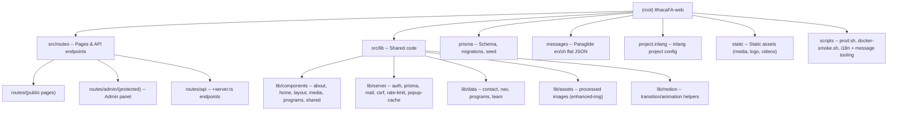

@AGENTS.md

# Ithaca Family Academy -- Official Website

## Changelog

| Date       | Action    | Notes                                                                                                                                                                                                                                                                                                                                                                                                                                                        |
| ---------- | --------- | ------------------------------------------------------------------------------------------------------------------------------------------------------------------------------------------------------------------------------------------------------------------------------------------------------------------------------------------------------------------------------------------------------------------------------------------------------------ |
| 2026-08-27 | Reorg     | **Repo cleanup & reorg**: the legacy Next.js 16 tree was decommissioned and the SvelteKit 2 app promoted from `sveltekit/` to the repository root. Stack is now SvelteKit 2 + Svelte 5 (runes), adapter-node, Better Auth, Paraglide (flat `messages/{en,zh}.json`), Prisma + PostgreSQL, nodemailer, Threlte. CI collapsed to one `deploy.yml` (SvelteKit → `ghcr.io/<repo>-kit`) + `lighthouse.yml`, both at root paths. Docs rewritten for the new stack. |
| 2026-08-25 | (Next.js) | Historical: Phase 0 bugfixes on the retired Next.js app (kept for provenance).                                                                                                                                                                                                                                                                                                                                                                               |
| 2026-04-17 | Created   | Initial architecture scan (Next.js era).                                                                                                                                                                                                                                                                                                                                                                                                                     |

## Project Vision

Ithaca Family Academy (IFA) is a youth-education organization based in Ontario, Canada,
focused on AI, engineering, and entrepreneurship for teens. This repository is the
**official public website and admin CMS**, built as a **SvelteKit 2** full-stack application
(Svelte 5, adapter-node) with a PostgreSQL database, Prisma ORM, Better Auth, and nodemailer
email delivery.

The site serves two audiences:

1. **Public visitors** -- parents and students browsing programs, reading about IFA,
   and submitting contact/subscribe forms.
2. **Administrators** -- staff who manage subscribers, send email campaigns, and
   configure popup banners through a protected admin panel.

## Architecture Overview

```
SvelteKit 2 (Svelte 5 runes, @sveltejs/adapter-node -> standalone build/index.js)
  |
  |-- i18n                Paraglide (@inlang/paraglide-js), en/zh bilingual
  |                       Locale from URL only (prerender-safe): '/' = en, '/zh' = zh
  |                       Messages: flat messages/{en,zh}.json -> compiled to src/lib/paraglide
  |                       Strategy + urlPatterns configured INLINE in vite.config.ts
  |
  |-- Public pages        /                (homepage)
  |                       /about-us
  |                       /programs/*      (8 program sub-pages + index)
  |                       /contact-us
  |                       /privacy  /terms (legal pages)
  |                       /sitemap.xml     (generated endpoint)
  |
  |-- Admin panel         /admin/login
  |                       /admin/(protected)/subscribers
  |                       /admin/(protected)/emails
  |                       /admin/(protected)/popups
  |                       (session guard in src/hooks.server.ts)
  |
  |-- API routes          /api/subscribe            POST  (public, rate-limited)
  |   (+server.ts)        /api/contact              POST  (public, rate-limited)
  |                       /api/auth/[...all]         ALL   (Better Auth handler)
  |                       /api/popups/active         GET   (public)
  |                       /api/admin/subscribers     GET|DELETE (auth)
  |                       /api/admin/contacts        GET   (auth)
  |                       /api/admin/emails          GET|POST   (auth)
  |                       /api/admin/emails/send     POST       (auth)
  |                       /api/admin/popups          GET|POST|PUT|DELETE (auth)
  |
  |-- Database            PostgreSQL 16 via Prisma
  |                       App models: Subscriber, ContactMessage, EmailCampaign, Popup
  |                       Auth models: User, Session, Account, Verification (Better Auth)
  |                       Legacy (retained until cutover): AdminUser  (see docs/CUTOVER.md §7)
  |
  |-- Email               nodemailer SMTP (graceful no-op when SMTP unset)
```

## Module Structure



## Module Index

| Module Path          | Language  | Purpose                                                                                                    |
| -------------------- | --------- | ---------------------------------------------------------------------------------------------------------- |
| `src/routes`         | Svelte/TS | Pages (`+page.svelte`), loaders (`+page.ts`/`+page.server.ts`), API (`+server.ts`)                         |
| `src/lib/components` | Svelte    | UI components (about, home, layout, media, programs, shared)                                               |
| `src/lib/server`     | TS        | Server-only: `auth.ts` (Better Auth), `prisma.ts`, `mail.ts`, `csrf.ts`, `rate-limit.ts`, `popup-cache.ts` |
| `src/lib/data`       | TS        | Static content data: `team.ts`, `nav.ts`, `programs.ts`, `contact.ts`                                      |
| `src/lib/assets`     | Images    | Build-processed images (`@sveltejs/enhanced-img`)                                                          |
| `src/lib/motion`     | TS        | Animation / transition helpers (GSAP, Svelte transitions)                                                  |
| `src/lib/paraglide`  | TS (gen)  | Paraglide-compiled i18n runtime -- **generated, gitignored**                                               |
| `prisma`             | Prisma/TS | `schema.prisma`, `migrations/`, `seed.ts`, `migrate-admins-to-betterauth.ts`                               |
| `messages`           | JSON      | Paraglide message catalogs: `en.json`, `zh.json` (flat)                                                    |
| `project.inlang`     | JSON      | inlang project settings (`settings.json`)                                                                  |
| `static`             | Static    | `media/` (images, videos), logo, favicons                                                                  |
| `scripts`            | Bash/TS   | `prod.sh` (SSH ops), `docker-smoke.sh`, `check-i18n.ts`, `migrate-messages.ts`                             |

## Run & Develop

### Prerequisites

- Node.js 20+ (`.npmrc` sets `engine-strict=true`)
- Docker (for local PostgreSQL)
- npm

### Quick Start

```bash
cp .env.example .env                              # then fill in values
docker compose -f docker-compose.dev.yml up -d    # PostgreSQL 16 on :5432
npm install
npm run db:migrate:deploy                          # apply migrations
npm run db:seed                                    # seed an admin user
npm run dev                                         # Vite dev server -> http://localhost:5173
```

The production server (`node build/index.js`, and the Docker image) listens on **:3000**.

### Key npm Scripts

| Command                     | Description                                                 |
| --------------------------- | ----------------------------------------------------------- |
| `npm run dev`               | Vite dev server (default `:5173`)                           |
| `npm run build`             | Production build (adapter-node -> `build/index.js`)         |
| `npm run preview`           | Preview the production build                                |
| `npm run start`             | Run the built server (`node build/index.js`)                |
| `npm run check`             | `paraglide-js compile` + `svelte-kit sync` + `svelte-check` |
| `npm run lint`              | `eslint .` + `prettier --check .`                           |
| `npm run format`            | `prettier --write .`                                        |
| `npm run db:migrate`        | Prisma migrate (dev)                                        |
| `npm run db:migrate:deploy` | Apply migrations (production)                               |
| `npm run db:migrate:status` | Show migration status                                       |
| `npm run db:seed`           | Seed admin user (`prisma/seed.ts`)                          |
| `npm run db:studio`         | Open Prisma Studio                                          |
| `npm run prod:deploy`       | Deploy to prod via `scripts/prod.sh` (SSH `ops`)            |

### Environment Variables

| Variable                                                                | Required   | Description                                                               |
| ----------------------------------------------------------------------- | ---------- | ------------------------------------------------------------------------- |
| `DATABASE_URL`                                                          | Yes        | PostgreSQL connection string                                              |
| `BETTER_AUTH_SECRET`                                                    | Yes (prod) | Signs Better Auth sessions                                                |
| `BETTER_AUTH_URL`                                                       | Yes        | Canonical public origin for cookies/redirects                             |
| `ORIGIN`                                                                | Yes (prod) | adapter-node CSRF origin + absolute URLs                                  |
| `ADDRESS_HEADER` / `PROTOCOL_HEADER` / `HOST_HEADER`                    | No         | Trust headers behind Cloudflare (baked in Dockerfile)                     |
| `PUBLIC_SITE_URL`                                                       | Build      | Canonical origin for SEO/OG/sitemap -- **inlined at build time**          |
| `PUBLIC_GA_TRACKING_ID`                                                 | Build      | Google Analytics ID -- **inlined at build time** (default `G-675W5PPJEJ`) |
| `SMTP_HOST` / `SMTP_PORT` / `SMTP_USER` / `SMTP_PASSWORD` / `SMTP_FROM` | No         | nodemailer; unset = sends skipped                                         |
| `UPSTASH_REDIS_REST_URL` / `_TOKEN`                                     | No         | Distributed rate limiting; unset = in-memory                              |
| `ADMIN_EMAIL` / `ADMIN_PASSWORD`                                        | Seed       | Used only by `prisma/seed.ts`                                             |

**Note:** `PUBLIC_*` values are read via `$env/static/public` and inlined by Vite at build
time, so they must be present **before** `npm run build`. In Docker/CI they are supplied as
build-args (`Dockerfile` + `.github/workflows/deploy.yml`).

### Docker

- **Dev**: `docker-compose.dev.yml` -- PostgreSQL 16 only (port 5432); SvelteKit runs on host.
  Credentials: `ithacafa` / `ithacafa_dev_2026` / database `ithacafa`.
- **Prod**: `Dockerfile` -- multi-stage build producing a standalone adapter-node server on
  port 3000. The container CMD runs `prisma migrate deploy` (fail-loud) then `node build/index.js`.
  Smoke-test the image end-to-end with `bash scripts/docker-smoke.sh`.

## Testing Strategy

**Vitest is wired** (`vitest` ^4, config inline in `vite.config.ts` under `test:`) with **15
test files**. Note `environment: 'node'` -- there is no jsdom and no `@testing-library/svelte`,
so every `*.test.ts` is a pure-logic test, including the ones under `src/lib/components/`.
UI-level verification is Playwright's job (`e2e/`), not Vitest's.

- `npm test` -- `vitest run` (unit tests; `npm run test:watch` for the watcher)
- `npm run check` -- Paraglide compile + `svelte-kit sync` + `svelte-check` (types + a11y)
- `npm run lint` -- ESLint + Prettier
- `npm run i18n:check` -- en/zh message-key parity (`scripts/check-i18n.ts`)
- `npm run build` -- production build must emit `build/index.js`
- `npm run test:e2e` -- Playwright against the **production build**, not `vite dev`. Requires
  `npm run build` first. Boots `node build/index.js` on port 4321 (NOT 3000, which is commonly
  squatted by local daemons; `reuseExistingServer` is off so a busy port fails loudly instead
  of silently testing someone else's server).
  - `e2e/smoke.spec.ts` -- route coverage **derived from `/sitemap.xml`**, so a new page joins
    the suite automatically; plus locale switch, keyboard nav, form validation, redirects
  - `e2e/a11y.spec.ts` -- axe, zero serious/critical on every `prd.md` §6.4 page in both locales
  - `e2e/header-contrast.spec.ts` -- samples the pixels BEHIND the header on every sitemap route
    and asserts 4.5:1 for each nav link / hamburger / switcher. axe cannot do this: it reports
    text-over-image contrast as `incomplete`, which is how 40 of 84 elements shipped below AA
- `bash scripts/docker-smoke.sh` -- production-image smoke test (build + migrate + routes +
  Better Auth login) against an isolated, disposable Postgres
- `.github/workflows/ci.yml` -- **the PR gate**: lint, check, i18n parity, unit tests, build,
  Playwright smoke, axe
- `.github/workflows/lighthouse.yml` -- mobile performance gate. The thresholds that actually
  block are in `lighthouserc.json` and are only two: LCP <= 4500ms and CLS <= 0.05

## Coding Conventions

- **Language**: TypeScript (strict), Svelte 5 components (`.svelte`)
- **Framework**: SvelteKit 2 (`@sveltejs/kit`), `@sveltejs/adapter-node`
- **Reactivity**: Svelte 5 **runes** (`$state` / `$derived` / `$effect` / `$props`) -- forced on for app code via `compilerOptions.runes` in `vite.config.ts`
- **Config**: **No `svelte.config.js`** -- SvelteKit, Paraglide, enhanced-img, adapter, CSRF, and prerender are all configured **inline** in `vite.config.ts`
- **Styling**: Tailwind CSS v4 via `@tailwindcss/vite`
- **Fonts**: `@fontsource/outfit` (Latin) + `@fontsource/noto-sans-sc` (Chinese), self-hosted
- **UI library**: No external component library; hand-rolled components under `src/lib/components`
- **Animations**: Svelte transitions + GSAP (`gsap`); respect reduced-motion
- **3D rendering**: Threlte (`@threlte/core` + `@threlte/extras`) over `three` (EV Challenge page); `ssr.noExternal: ['three']` in `vite.config.ts`
- **Images**: `@sveltejs/enhanced-img` for processed imports under `src/lib/assets`; runtime static assets live in `static/media`
- **i18n**: Paraglide (`@inlang/paraglide-js`); locale from URL only; see the i18n section below
- **Icons**: `lucide-svelte`
- **Forms**: SvelteKit **form actions** (`+page.server.ts`), validated with `zod` v4
- **Auth**: Better Auth (`better-auth`) credential provider (email/password, bcrypt via `bcryptjs`); session resolved in `src/hooks.server.ts`
- **Database**: Prisma ORM with PostgreSQL; `@prisma/client` singleton in `src/lib/server/prisma.ts`
- **Email**: nodemailer SMTP in `src/lib/server/mail.ts` with graceful degradation (no-op when SMTP unset)
- **Validation**: Zod v4 in endpoints/actions; `safeParse` pattern
- **Path alias**: `$lib` -> `src/lib` (SvelteKit default). There is **no** `@/*` alias.
- **Server-only code**: everything under `src/lib/server/**` must never be imported client-side
- **Rate limiting**: sliding-window limiter in `src/lib/server/rate-limit.ts` on public POST routes (`/api/subscribe`, `/api/contact`); optional Upstash Redis backing
- **CSRF**: `src/lib/server/csrf.ts` (+ `src/lib/csrf-client.ts`); SvelteKit same-origin POST protection plus `csrf.trustedOrigins` in `vite.config.ts`
- **Analytics**: Google Analytics (gtag.js), ID inlined from `PUBLIC_GA_TRACKING_ID`

## Internationalization (i18n)

The site uses **Paraglide** (`@inlang/paraglide-js`) for bilingual English/Chinese support.

### Architecture

- **Locale strategy** (in `vite.config.ts`, `paraglideVitePlugin`): `['url', 'baseLocale']` --
  locale is derived from the URL only, which keeps every page prerender-safe (no cookie/header).
- **URL patterns**: `/` serves English; `/zh/*` serves Chinese. `/admin/*` and `/api/*` are
  **not** localized (identical mapping for both locales; listed before the catch-all).
- **Messages**: flat `messages/en.json` + `messages/zh.json` (Paraglide format -- one file per
  locale, **not** namespaced directories).
- **Compiled runtime**: `paraglide-js compile` emits `src/lib/paraglide` (generated, gitignored);
  it runs via the `prepare` and `check` npm scripts.
- **Project config**: `project.inlang/settings.json` (strategy + urlPatterns live in `vite.config.ts`, not here).

### i18n Patterns

- Import messages from the generated `$lib/paraglide/messages` (e.g. `m.hero_title()`), and
  locale helpers from `$lib/paraglide/runtime`.
- Add every new key to **both** `messages/en.json` and `messages/zh.json`.
- Run `npm run check` (compiles Paraglide) after adding keys; `scripts/check-i18n.ts` checks
  en/zh key parity. `scripts/migrate-messages.ts` is the one-off importer from the old
  next-intl namespaced files.
- Team data lives in `src/lib/data/team.ts` and references static headshots under
  `static/media/images/team/`.

## AI Usage Guidelines

- **IMPORTANT**: This is SvelteKit 2 + Svelte 5 (runes). APIs differ from older Svelte and from
  most training data -- verify against the versions pinned in `package.json`, and read
  `vite.config.ts` (the config is inline; there is no `svelte.config.js`).
- Read `prisma/schema.prisma` before any DB work.
- HTTP endpoints are `+server.ts` handlers under `src/routes/api/**`; validate with Zod.
- Better Auth mounts at `src/routes/api/auth/[...all]`; the session is resolved in
  `src/hooks.server.ts`, which also guards `src/routes/admin/(protected)/**`.
- The nodemailer transport may be a no-op in development (SMTP unset); code must tolerate that.
- **i18n**: all user-facing text goes through Paraglide messages; add keys to both
  `messages/en.json` and `messages/zh.json`, then run `npm run check`.
- **Server-only** modules live in `src/lib/server/**` and must never be imported into client code.
- **GSAP / Threlte**: register/clean up GSAP contexts and check reduced-motion; load Threlte/three
  only where needed (they are bundled for SSR via `ssr.noExternal: ['three']`).
- The container CMD runs `prisma migrate deploy` on boot, so **any committed migration
  auto-applies on the next `-kit` rollout**. Keep migrations additive (new columns nullable or
  defaulted) and take `npm run prod:backup` first. The legacy `AdminUser` model no longer
  exists -- it was dropped by `20260926162933_drop_legacy_admin_users`.
- `docs/DECISIONS.md` records every deviation from the PRD, `docs/CONTENT-GAPS.md` tracks what
  is still owed by the owner, and `docs/LAUNCH-CHECKLIST.md` is the release gate.
- Vitest is set up (`npm test` = `vitest run`; config inline in `vite.config.ts`). Put unit tests
  next to their target as `*.test.ts` (see `src/lib/utils.test.ts` for the pattern).
