@AGENTS.md

# Ithaca Family Academy -- Official Website

## Changelog

| Date       | Action  | Notes                                      |
|------------|---------|---------------------------------------------|
| 2026-08-25 | Updated | Phase 0 bugfixes + dependency patches: PopupBanner `buttonLink` fix, dashboard real contact count (`/api/admin/contacts`), GA now injected via `NEXT_PUBLIC_GA_TRACKING_ID` build-arg, Upstash rate-limit per-config keyed cache, `middleware.ts` renamed to `proxy.ts` (Next 16 convention) with fail-closed `getToken`, new `/privacy` + `/terms` legal pages (`legal` namespace), deps upgraded (next 16.3.x, next-auth 4.24.15, nodemailer 7.x) and `@auth/prisma-adapter` removed. |
| 2026-06-25 | Updated | Incremental rescan: confirmed about-us cleanup (13 legacy section files removed, 9 active remain), verified all modules unchanged, updated index.json inactive refs, scripts module now 2 files (dev.sh + check-i18n.ts). |
| 2026-06-25 | Updated | Full rescan: i18n docs, font/color corrections, new components (CinematicDivider, ImpactStats, EVModel3D, LanguageSwitcher), about-us redesign (9 active sections, 13 legacy removed), elite-interview route, 404 page, GSAP/Three.js deps, module docs updated. |
| 2026-06-14 | Updated | Full deep scan; added module-level CLAUDE.md files, updated index.json. |
| 2026-06-14 | Updated | Sync: GA tracking, rate-limit, HTML escape, new scripts. |
| 2026-04-17 | Created | Initial architecture scan; full coverage.   |

## Project Vision

Ithaca Family Academy (IFA) is a youth-education organization based in Ontario, Canada,
focused on AI, engineering, and entrepreneurship for teens. This repository is the
**official public website and admin CMS**, built as a Next.js 16 full-stack application
with a PostgreSQL database, Prisma ORM, and Resend email delivery.

The site serves two audiences:

1. **Public visitors** -- parents and students browsing programs, reading about IFA,
   and submitting contact/subscribe forms.
2. **Administrators** -- staff who manage subscribers, send email campaigns, and
   configure popup banners through a protected admin panel.

## Architecture Overview

```
Next.js 16 (App Router, standalone output)
  |
  |-- i18n                next-intl v4 (en/zh bilingual)
  |                       Locale detection: cookie (NEXT_LOCALE) -> Accept-Language -> default 'en'
  |                       Message files: messages/{en,zh}/*.json (8 namespaces)
  |                       URL prefix: none (localePrefix: 'never')
  |
  |-- Public pages        /                (homepage)
  |                       /about-us
  |                       /programs/*      (6 program sub-pages + index)
  |                       /contact-us
  |                       /not-found       (custom 404)
  |
  |-- Admin panel         /admin           (JWT-protected)
  |                       /admin/login
  |                       /admin/subscribers
  |                       /admin/emails
  |                       /admin/popups
  |
  |-- API routes          /api/subscribe          POST  (public, rate-limited)
  |                       /api/contact            POST  (public, rate-limited)
  |                       /api/auth/[...nextauth] GET|POST
  |                       /api/admin/subscribers   GET|DELETE (auth)
  |                       /api/admin/emails        GET|POST  (auth)
  |                       /api/admin/emails/send   POST      (auth)
  |                       /api/admin/popups        GET|POST|PUT|DELETE (auth)
  |                       /api/admin/popups/active GET  (public)
  |
  |-- Database            PostgreSQL 16 via Prisma
  |                       Models: Subscriber, ContactMessage,
  |                               AdminUser, EmailCampaign, Popup
  |
  |-- Email               Resend (transactional + batch campaigns)
```

## Module Structure

```mermaid
graph TD
    A["(root) ItahcaFA-web"] --> B["src/app -- Pages & API Routes"]
    A --> C["src/components -- React Components"]
    A --> D["src/lib -- Shared Utilities"]
    A --> E["src/types -- TypeScript Types & Constants"]
    A --> I["src/i18n -- Internationalization Config"]
    A --> M["messages -- Translation Files (en/zh)"]
    A --> F["prisma -- Database Schema & Seeds"]
    A --> G["scripts -- Dev Tooling"]
    A --> H["public -- Static Assets"]

    B --> B1["app/(public pages)"]
    B --> B2["app/admin -- Admin Panel"]
    B --> B3["app/api -- API Routes"]

    C --> C1["components/home"]
    C --> C2["components/layout"]
    C --> C3["components/shared"]
    C --> C4["components/ui"]
    C --> C5["components/animations"]
    C --> C6["components/contact"]
    C --> C7["components/programs"]

    click B "src/app/CLAUDE.md" "View src/app module docs"
    click C "src/components/CLAUDE.md" "View src/components module docs"
    click D "src/lib/CLAUDE.md" "View src/lib module docs"
    click F "prisma/CLAUDE.md" "View prisma module docs"
```



## Module Index

| Module Path           | Language   | Purpose                                      | Module Docs |
|-----------------------|------------|----------------------------------------------|-------------|
| `src/app`             | TSX        | Next.js App Router pages and API routes      | [CLAUDE.md](src/app/CLAUDE.md) |
| `src/components`      | TSX        | Reusable React UI components                 | [CLAUDE.md](src/components/CLAUDE.md) |
| `src/lib`             | TS         | Prisma client, auth, Resend, rate-limit, utils | [CLAUDE.md](src/lib/CLAUDE.md) |
| `src/types`           | TS         | Shared interfaces, constants, navigation     | (inline -- single file) |
| `src/i18n`            | TS         | next-intl routing config and locale request handler | (inline -- 2 files) |
| `messages`            | JSON       | Translation files: 8 namespaces x 2 locales (en/zh) | (inline -- JSON assets) |
| `prisma`              | Prisma/TS  | Database schema and admin seed script        | [CLAUDE.md](prisma/CLAUDE.md) |
| `scripts`             | Bash/TS    | Dev tooling: `dev.sh` (local stack), `check-i18n.ts` (key parity) | (inline -- 2 files) |
| `public`              | Static     | Images, videos, SVGs                         | (binary assets only) |

## Run & Develop

### Prerequisites

- Node.js 20+
- Docker (for local PostgreSQL)
- npm

### Quick Start

```bash
# One-command start: spins up PostgreSQL, seeds admin, starts dev server
./scripts/dev.sh

# Or manually:
docker compose -f docker-compose.dev.yml up -d   # start PostgreSQL
npm install
npx prisma migrate deploy                         # apply migrations
npx tsx prisma/seed.ts                            # seed admin user
npm run dev                                       # http://localhost:3000
```

### Key npm Scripts

| Command            | Description                          |
|--------------------|--------------------------------------|
| `npm run dev`      | Start Next.js dev server             |
| `npm run dev:up`   | Full local stack (Docker + dev)      |
| `npm run dev:stop` | Stop all dev services                |
| `npm run dev:clean`| Wipe DB volume and stop              |
| `npm run dev:status`| Show dev service status             |
| `npm run build`    | Production build (standalone)        |
| `npm run start`    | Start production server              |
| `npm run lint`     | ESLint check                         |
| `npm run db:migrate`| Run Prisma migrations (dev)          |
| `npm run db:migrate:deploy`| Apply migrations (production) |
| `npm run db:migrate:status`| Show migration status         |
| `npm run db:migrate:reset`| Reset DB and reapply all       |
| `npm run db:seed`  | Seed admin user                      |
| `npm run db:studio`| Open Prisma Studio                   |
| `npm run prisma:seed`| Alias for `db:seed`                |
| `npm run i18n:check` | Check i18n key parity (en vs zh)   |

### Environment Variables

| Variable           | Required | Description                              |
|--------------------|----------|------------------------------------------|
| `DATABASE_URL`     | Yes      | PostgreSQL connection string             |
| `NEXTAUTH_URL`     | Yes      | Canonical URL (e.g., `http://localhost:3000`) |
| `NEXTAUTH_SECRET`  | Yes      | JWT signing secret                       |
| `RESEND_API_KEY`   | No       | Resend API key (empty = skip emails)     |
| `ADMIN_EMAIL`      | Seed     | Admin email for `prisma/seed.ts`         |
| `ADMIN_PASSWORD`   | Seed     | Admin password for `prisma/seed.ts`      |

**Note:** Google Analytics tracking ID is injected at build time via the
`NEXT_PUBLIC_GA_TRACKING_ID` environment variable (read in `src/app/layout.tsx`).
In Docker/CI it is supplied as a build-arg (`Dockerfile` + `.github/workflows/deploy.yml`),
defaulting to `G-675W5PPJEJ`. NEXT_PUBLIC_* values are inlined at build time, so the
variable must be present before `npm run build`.

### Docker

- **Dev**: `docker-compose.dev.yml` -- PostgreSQL 16 only (port 5432); Next.js runs on host.
  Credentials: `ithacafa` / `ithacafa_dev_2026` / database `ithacafa`.
- **Prod**: `Dockerfile` -- multi-stage build producing standalone Node.js server on port 3000.
  Runs `prisma migrate deploy` before starting the server.

## Testing Strategy

**No test suite exists yet.** There are no `tests/`, `__tests__/`, `*.spec.*`, or `*.test.*` files in the repository.

Recommended approach:
- **Unit tests**: Zod schemas, utility functions (`src/lib/utils.ts`, `src/lib/rate-limit.ts`)
- **Integration tests**: API route handlers (subscribe, contact, admin CRUD)
- **E2E tests**: Playwright for public page navigation and admin login flow

## Coding Conventions

- **Language**: TypeScript (strict mode), TSX for components
- **Framework**: Next.js 16 App Router with `output: "standalone"`
- **Styling**: Tailwind CSS v4 via `@tailwindcss/postcss`; CSS custom properties for theming in `globals.css`
- **Font**: Outfit (Latin) + Noto Sans SC (Chinese) via `next/font/google`
- **UI library**: No external component library; hand-rolled `Button`, `SectionHeading`, etc.
- **Animations**: Framer Motion (`framer-motion`) for scroll/entry animations; GSAP (`gsap`) for scroll-driven and timeline animations (CinematicDivider, ImpactStats, EVModel3D, WorkshopToRolesTransition)
- **3D rendering**: React Three Fiber (`@react-three/fiber` + `@react-three/drei` + `three`) for 3D model viewers (EV Challenge page)
- **i18n**: `next-intl` v4 with cookie-based locale switching (`NEXT_LOCALE` cookie); locales: `en` (default), `zh`; URL prefix: `never` (no locale segment in URLs); message namespaces: `common`, `nav`, `home`, `about`, `programs`, `contact`, `admin`, `metadata`
- **Icons**: `lucide-react`
- **Forms**: `react-hook-form` + `@hookform/resolvers` + `zod/v4`
- **Auth**: `next-auth` v4 with Credentials provider, JWT strategy
- **Database**: Prisma ORM with PostgreSQL; `@prisma/client` singleton in `src/lib/prisma.ts`
- **Email**: Resend SDK with graceful degradation (null client if no API key)
- **Validation**: Zod v4 schemas in API routes; `safeParse` pattern throughout
- **API response envelope**: `{ success: boolean; data?: T; error?: string }`
- **Path aliases**: `@/*` maps to `./src/*`
- **Linting**: ESLint with `eslint-config-next` (core-web-vitals + TypeScript)
- **CSS convention**: Dark-first palette (`#111318` background, `#f0f1f3` foreground); accent `#ccdef0`; grain texture overlay on body
- **Middleware**: JWT check on `/admin/*` routes (except `/admin/login`)
- **Rate limiting**: In-memory sliding-window limiter (`src/lib/rate-limit.ts`) on public API routes
  - `/api/subscribe`: 10 requests per 60 seconds per IP
  - `/api/contact`: 5 requests per 60 seconds per IP
- **HTML sanitization**: `escapeHtml()` in `src/lib/utils.ts` for user input in email templates
- **Analytics**: Google Analytics (gtag.js) loaded via `next/script` in root layout

## Internationalization (i18n)

The site uses `next-intl` v4 for bilingual English/Chinese support.

### Architecture

- **Locale detection** (in `src/i18n/request.ts`): `NEXT_LOCALE` cookie -> `Accept-Language` header -> fallback `en`
- **Locale switching**: `LanguageSwitcher` component sets `NEXT_LOCALE` cookie (1-year expiry) and calls `router.refresh()`
- **URL strategy**: `localePrefix: 'never'` -- no locale segment in URLs; same URL serves both languages
- **Root layout**: `NextIntlClientProvider` wraps all content; `html lang` attribute set dynamically
- **Config integration**: `next.config.ts` wraps the Next.js config with `createNextIntlPlugin()`

### Message Namespaces

| Namespace  | File pattern                    | Coverage                           |
|------------|---------------------------------|------------------------------------|
| `common`   | `messages/{locale}/common.json` | Footer text, team member bios      |
| `nav`      | `messages/{locale}/nav.json`    | Navigation labels                  |
| `home`     | `messages/{locale}/home.json`   | All homepage sections              |
| `about`    | `messages/{locale}/about.json`  | About-us page sections             |
| `programs` | `messages/{locale}/programs.json` | All program pages                |
| `contact`  | `messages/{locale}/contact.json`| Contact page, forms, newsletter    |
| `admin`    | `messages/{locale}/admin.json`  | Admin panel UI strings             |
| `metadata` | `messages/{locale}/metadata.json` | Page titles, OG tags             |

### i18n Patterns

- **Server components**: `const t = await getTranslations("namespace")`
- **Client components**: `const t = useTranslations("namespace")`
- **Metadata**: `export async function generateMetadata() { const t = await getTranslations("metadata.subKey"); ... }`
- **Nested keys**: Access via dot notation, e.g., `t("hero.title")`
- **Team data**: `TEAM_MEMBERS` in `src/types/index.ts` stores translation keys (not raw text); resolved at render time via `t(member.title)`
- **Key parity check**: `npm run i18n:check` runs `scripts/check-i18n.ts` to detect missing keys between en and zh

## AI Usage Guidelines

- **IMPORTANT**: This project uses Next.js 16 which may have breaking changes.
  Always read `node_modules/next/dist/docs/` before writing any Next.js-specific code.
- The Prisma schema is at `prisma/schema.prisma` -- read it before any DB work.
- All API routes follow the same pattern: validate with Zod, check auth (admin routes),
  operate via Prisma, return `ApiResponse<T>` envelope.
- The `resend` client may be `null` in development; always use optional chaining
  (`resend?.emails.send(...)`) or the `requireResend()` helper for mandatory sends.
- Client components use `"use client"` directive; server components are the default.
- **i18n**: All user-facing text must use `useTranslations()` (client) or `getTranslations()`
  (server) from `next-intl`. Add keys to both `messages/en/*.json` and `messages/zh/*.json`.
  The locale is detected via `NEXT_LOCALE` cookie -> `Accept-Language` header -> default `'en'`.
  The `next.config.ts` wraps the config with `createNextIntlPlugin()`.
  Run `npm run i18n:check` to verify en/zh key parity after adding translation keys.
- No test infrastructure exists yet -- set up Vitest or Jest before writing tests.
- The admin layout (`src/app/admin/layout.tsx`) is a client component with
  `SessionProvider` wrapping; it renders a sidebar for authenticated users and
  bypasses it entirely for the `/admin/login` route.
- Email campaigns use batch sending via `resend.batch.send()` with a batch size of 50.
- Popup banners are fetched client-side on every page load and dismissed per session
  via `sessionStorage`.
- **GSAP animations**: Components using GSAP (CinematicDivider, ImpactStats, EVModel3D,
  WorkshopToRolesTransition) must register ScrollTrigger via `gsap.registerPlugin(ScrollTrigger)`
  and clean up contexts in `useLayoutEffect` return. Always check `useReducedMotion()`
  from Framer Motion and provide graceful fallbacks.
- **Three.js components**: Use `dynamic(() => import(...), { ssr: false })` for Three.js
  components to prevent server-side rendering issues.
