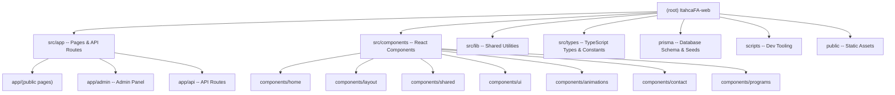

@AGENTS.md

# Ithaca Family Academy -- Official Website

## Changelog

| Date       | Action  | Notes                                      |
|------------|---------|---------------------------------------------|
| 2026-04-17 | Created | Initial architecture scan; full coverage.   |

## Project Vision

Ithaca Family Academy (IFA) is a youth-education organization based in Ontario, Canada,
focused on AI, engineering, and entrepreneurship for teens. This repository is the
**official public website and admin CMS**, built as a Next.js 16 full-stack application
with a PostgreSQL database, Prisma ORM, and Resend email delivery.

The site serves two audiences:

1. **Public visitors** -- parents and students browsing programs, reading about IFA,
   and submitting contact/subscribe forms.
2. **Administrators** -- staff who manage subscribers, send email campaigns, and
   configure popup banners through a protected admin panel.

## Architecture Overview

```
Next.js 16 (App Router, standalone output)
  |
  |-- Public pages        /                (homepage)
  |                       /about-us
  |                       /programs/*
  |                       /contact-us
  |
  |-- Admin panel         /admin           (JWT-protected)
  |                       /admin/login
  |                       /admin/subscribers
  |                       /admin/emails
  |                       /admin/popups
  |
  |-- API routes          /api/subscribe          POST  (public)
  |                       /api/contact            POST  (public)
  |                       /api/auth/[...nextauth] GET|POST
  |                       /api/admin/subscribers   GET|DELETE (auth)
  |                       /api/admin/emails        GET|POST  (auth)
  |                       /api/admin/emails/send   POST      (auth)
  |                       /api/admin/popups        GET|POST|PUT|DELETE (auth)
  |                       /api/admin/popups/active GET  (public)
  |
  |-- Database            PostgreSQL 16 via Prisma
  |                       Models: Subscriber, ContactMessage,
  |                               AdminUser, EmailCampaign, Popup
  |
  |-- Email               Resend (transactional + batch campaigns)
```

## Module Structure



## Module Index

| Module Path           | Language   | Purpose                                      |
|-----------------------|------------|----------------------------------------------|
| `src/app`             | TSX        | Next.js App Router pages and API routes      |
| `src/components`      | TSX        | Reusable React UI components                 |
| `src/lib`             | TS         | Prisma client, auth config, Resend, utils    |
| `src/types`           | TS         | Shared interfaces, constants, navigation     |
| `prisma`              | Prisma/TS  | Database schema and admin seed script        |
| `scripts`             | Bash       | Local development launcher (`dev.sh`)        |
| `public`              | Static     | Images, videos, SVGs                         |

## Run & Develop

### Prerequisites

- Node.js 20+
- Docker (for local PostgreSQL)
- npm

### Quick Start

```bash
# One-command start: spins up PostgreSQL, seeds admin, starts dev server
./scripts/dev.sh

# Or manually:
docker compose -f docker-compose.dev.yml up -d   # start PostgreSQL
npm install
npx prisma db push                                # sync schema
npx tsx prisma/seed.ts                            # seed admin user
npm run dev                                       # http://localhost:3000
```

### Key npm Scripts

| Command            | Description                          |
|--------------------|--------------------------------------|
| `npm run dev`      | Start Next.js dev server             |
| `npm run dev:up`   | Full local stack (Docker + dev)      |
| `npm run dev:stop` | Stop all dev services                |
| `npm run dev:clean`| Wipe DB volume and stop              |
| `npm run build`    | Production build (standalone)        |
| `npm run start`    | Start production server              |
| `npm run lint`     | ESLint check                         |
| `npm run db:push`  | Push Prisma schema to DB             |
| `npm run db:seed`  | Seed admin user                      |
| `npm run db:studio`| Open Prisma Studio                   |

### Environment Variables

| Variable           | Required | Description                              |
|--------------------|----------|------------------------------------------|
| `DATABASE_URL`     | Yes      | PostgreSQL connection string             |
| `NEXTAUTH_URL`     | Yes      | Canonical URL (e.g., `http://localhost:3000`) |
| `NEXTAUTH_SECRET`  | Yes      | JWT signing secret                       |
| `RESEND_API_KEY`   | No       | Resend API key (empty = skip emails)     |
| `ADMIN_EMAIL`      | Seed     | Admin email for `prisma/seed.ts`         |
| `ADMIN_PASSWORD`   | Seed     | Admin password for `prisma/seed.ts`      |

### Docker

- **Dev**: `docker-compose.dev.yml` -- PostgreSQL 16 only; Next.js runs on host.
- **Prod**: `Dockerfile` -- multi-stage build producing standalone Node.js server.

## Testing Strategy

**No test suite exists yet.** There are no `tests/`, `__tests__/`, `*.spec.*`, or `*.test.*` files in the repository.

Recommended approach:
- **Unit tests**: Zod schemas, utility functions (`src/lib/utils.ts`)
- **Integration tests**: API route handlers (subscribe, contact, admin CRUD)
- **E2E tests**: Playwright for public page navigation and admin login flow

## Coding Conventions

- **Language**: TypeScript (strict mode), TSX for components
- **Framework**: Next.js 16 App Router with `output: "standalone"`
- **Styling**: Tailwind CSS v4 via `@tailwindcss/postcss`; CSS custom properties for theming in `globals.css`
- **Font**: Montserrat (Google Fonts via `next/font`)
- **UI library**: No external component library; hand-rolled `Button`, `SectionHeading`, etc.
- **Animations**: Framer Motion (`framer-motion`) for scroll/entry animations
- **Icons**: `lucide-react`
- **Forms**: `react-hook-form` + `@hookform/resolvers` + `zod/v4`
- **Auth**: `next-auth` v4 with Credentials provider, JWT strategy
- **Database**: Prisma ORM with PostgreSQL; `@prisma/client` singleton in `src/lib/prisma.ts`
- **Email**: Resend SDK with graceful degradation (null client if no API key)
- **Validation**: Zod v4 schemas in API routes; `safeParse` pattern throughout
- **API response envelope**: `{ success: boolean; data?: T; error?: string }`
- **Path aliases**: `@/*` maps to `./src/*`
- **Linting**: ESLint with `eslint-config-next` (core-web-vitals + TypeScript)
- **CSS convention**: Dark-first palette (`#161616` background); accent `#ccdef0`
- **Middleware**: JWT check on `/admin/*` routes (except `/admin/login`)

## AI Usage Guidelines

- **IMPORTANT**: This project uses Next.js 16 which may have breaking changes.
  Always read `node_modules/next/dist/docs/` before writing any Next.js-specific code.
- The Prisma schema is at `prisma/schema.prisma` -- read it before any DB work.
- All API routes follow the same pattern: validate with Zod, check auth (admin routes),
  operate via Prisma, return `ApiResponse<T>` envelope.
- The `resend` client may be `null` in development; always use optional chaining
  (`resend?.emails.send(...)`) or the `requireResend()` helper for mandatory sends.
- Client components use `"use client"` directive; server components are the default.
- No test infrastructure exists yet -- set up Vitest or Jest before writing tests.
